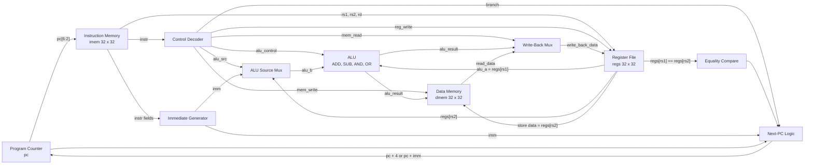
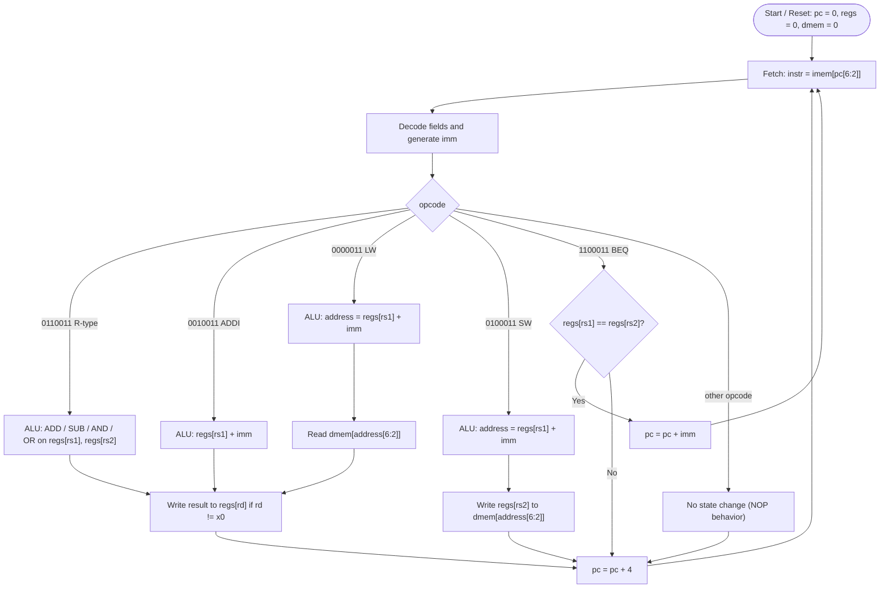

# 32-bit RISC Processor Design and Verification


-orange)


## 1. Project Overview

This project implements and verifies a small educational **32-bit, single-cycle RISC processor** using **Verilog HDL**. The instruction formats are **RISC-V-inspired**, and the processor supports a deliberately small instruction subset: `ADD`, `SUB`, `AND`, `OR`, `ADDI`, `LW`, `SW` and `BEQ`.

The design contains a program counter, instruction memory, a 32 x 32-bit register file, a main control decoder, an immediate generator, a 4-operation ALU, a data memory and next-PC logic. A **self-checking Verilog testbench** loads an 11-instruction program, runs it through reset and execution, and compares register and memory contents against expected values.

> **Scope note:** This is a learning-level, RISC-V-inspired subset. It is **not** a complete or compliant RV32I processor.

## 2. Project Objectives

- Understand the organization of a basic RISC processor datapath and control unit.
- Design RTL in Verilog for arithmetic, logic, load/store and branch instructions.
- Implement immediate generation for I-type, S-type and B-type instruction formats.
- Build a self-checking testbench with a directed test program.
- Verify register, data memory and branch behavior using Xilinx Vivado behavioral simulation.
- Observe internal processor signals (PC, instruction, ALU result, registers, data memory) in the waveform viewer.

## 3. Key Features

- 32-bit single-cycle processor: each instruction is executed in one clock cycle.
- 8 supported instructions across R-type, I-type, S-type and B-type formats.
- 32 x 32-bit register file with `x0` hardwired to zero.
- 32-word instruction memory and 32-word data memory.
- Asynchronous active-high reset (clears PC, register file and data memory).
- Combinational ALU with ADD, SUB, AND and OR operations.
- Taken-branch support for `BEQ` using PC-relative addressing.
- Self-checking testbench with an error counter and a final `PASSED` / `FAILED` message.
- Unsupported opcodes behave as no-operations (PC advances by 4, no state change).

## 4. Processor Architecture

The processor follows the classic single-cycle datapath organization:

1. **Fetch:** the program counter indexes instruction memory using `pc[6:2]` (word-addressed).
2. **Decode:** instruction fields (`opcode`, `rd`, `funct3`, `rs1`, `rs2`, `funct7`) are split out, the control decoder generates control signals, and the immediate generator builds the sign-extended immediate.
3. **Execute:** the ALU computes a result from `regs[rs1]` and either `regs[rs2]` or the immediate, selected by `alu_src`.
4. **Memory:** `LW` reads and `SW` writes data memory at address `alu_result[6:2]`.
5. **Write-back:** the result (ALU result, or memory data for `LW`) is written to `regs[rd]` on the clock edge.
6. **Next PC:** `pc + 4`, or `pc + imm` when `BEQ` is taken.

| Parameter | Value (from RTL) |
|---|---|
| Data width | 32 bits |
| Registers | 32 x 32-bit (`x0` fixed at zero) |
| Instruction memory | 32 words (indexed by `pc[6:2]`) |
| Data memory | 32 words (indexed by `alu_result[6:2]`) |
| ALU control | 2-bit (`alu_control`) |
| Reset | Asynchronous, active-high |
| Clock | Single clock, rising-edge triggered |
| Top module | `risc_processor` (ports: `clk`, `reset`) |

## 5. Block Diagram



## 6. Processor Components and Their Functions

| Component | RTL Signal / Element | Function |
|---|---|---|
| Program Counter | `pc` | Holds the address of the current instruction. Resets to `0`; updates every clock to `pc + 4` or `pc + imm`. |
| Instruction Memory | `imem [0:31]` | 32 x 32-bit array. Read combinationally as `imem[pc[6:2]]`. Loaded by the testbench. |
| Instruction Decoder | `opcode`, `rd`, `rs1`, `rs2`, `funct3`, `funct7` | Splits the 32-bit instruction into its fields using fixed bit positions. |
| Control Decoder | `always @(*)` block | Generates `reg_write`, `mem_write`, `mem_read`, `alu_src`, `branch` and `alu_control` from `opcode`, `funct3` and `funct7`. |
| Immediate Generator | `imm` | Produces sign-extended immediates for I-type (`ADDI`, `LW`), S-type (`SW`) and B-type (`BEQ`). Returns `0` for other opcodes. |
| Register File | `regs [0:31]` | 32 x 32-bit registers. Two combinational read ports, one synchronous write port. `x0` is forced to `0`. |
| ALU Source Mux | `alu_b` | Selects `regs[rs2]` or `imm` as the second ALU operand based on `alu_src`. |
| ALU | `alu_result_reg` | Performs ADD, SUB, AND or OR on `alu_a` and `alu_b`. Also computes load/store addresses. |
| Data Memory | `dmem [0:31]` | 32 x 32-bit array. Combinational read, synchronous write on `SW`. |
| Write-Back Mux | `write_back_data` | Selects memory read data (`LW`) or ALU result for the register write. |
| Next-PC Logic | inside clocked `always` block | Loads `pc + imm` when `branch` is set and `regs[rs1] == regs[rs2]`; otherwise `pc + 4`. |

### Control Signal Truth Table

| Instruction | Opcode | `reg_write` | `alu_src` | `mem_read` | `mem_write` | `branch` | `alu_control` |
|---|---|:---:|:---:|:---:|:---:|:---:|:---:|
| ADD | `0110011` | 1 | 0 | 0 | 0 | 0 | `00` |
| SUB | `0110011` | 1 | 0 | 0 | 0 | 0 | `01` |
| AND | `0110011` | 1 | 0 | 0 | 0 | 0 | `10` |
| OR | `0110011` | 1 | 0 | 0 | 0 | 0 | `11` |
| ADDI | `0010011` | 1 | 1 | 0 | 0 | 0 | `00` |
| LW | `0000011` | 1 | 1 | 1 | 0 | 0 | `00` |
| SW | `0100011` | 0 | 1 | 0 | 1 | 0 | `00` |
| BEQ | `1100011` | 0 | 0 | 0 | 0 | 1 | `00` (unused) |

### ALU Operations

| `alu_control` | Operation |
|:---:|---|
| `00` | `alu_a + alu_b` (ADD, ADDI, LW/SW address) |
| `01` | `alu_a - alu_b` (SUB) |
| `10` | `alu_a & alu_b` (AND) |
| `11` | `alu_a \| alu_b` (OR) |

## 7. Supported Instruction Set

Only the following instructions are implemented in `rtl/risc_processor.v`:

| Instruction | Type | Operation | Opcode | `funct3` | `funct7` | Example |
|---|---|---|---|---|---|---|
| `ADD` | R | `rd = rs1 + rs2` | `0110011` | `000` | `0000000` | `ADD x3, x1, x2` |
| `SUB` | R | `rd = rs1 - rs2` | `0110011` | `000` | `0100000` | `SUB x4, x2, x1` |
| `AND` | R | `rd = rs1 & rs2` | `0110011` | `111` | not checked | `AND x6, x1, x2` |
| `OR` | R | `rd = rs1 \| rs2` | `0110011` | `110` | not checked | `OR x7, x1, x2` |
| `ADDI` | I | `rd = rs1 + imm` | `0010011` | `000` | n/a | `ADDI x1, x0, 10` |
| `LW` | I | `rd = dmem[rs1 + imm]` | `0000011` | `010` | n/a | `LW x5, 0(x0)` |
| `SW` | S | `dmem[rs1 + imm] = rs2` | `0100011` | `010` | n/a | `SW x3, 0(x0)` |
| `BEQ` | B | `if (rs1 == rs2) pc = pc + imm` | `1100011` | `000` | n/a | `BEQ x3, x5, +8` |

### Instruction Formats

| Type | Bit Fields (MSB to LSB) |
|---|---|
| R-type | `funct7[31:25] \| rs2[24:20] \| rs1[19:15] \| funct3[14:12] \| rd[11:7] \| opcode[6:0]` |
| I-type | `imm[11:0] \| rs1 \| funct3 \| rd \| opcode` |
| S-type | `imm[11:5] \| rs2 \| rs1 \| funct3 \| imm[4:0] \| opcode` |
| B-type | `imm[12] \| imm[10:5] \| rs2 \| rs1 \| funct3 \| imm[4:1] \| imm[11] \| opcode` |

### Test Program and Machine Code

The testbench loads the following program into `imem`. The remaining locations are filled with `NOP` (`32'h00000013`, equivalent to `ADDI x0, x0, 0`).

| `imem` Index | Address | Machine Code | Assembly | Effect |
|:---:|:---:|:---:|---|---|
| 0 | `0x00` | `00A00093` | `ADDI x1, x0, 10` | `x1 = 10` |
| 1 | `0x04` | `01400113` | `ADDI x2, x0, 20` | `x2 = 20` |
| 2 | `0x08` | `002081B3` | `ADD  x3, x1, x2` | `x3 = 30` |
| 3 | `0x0C` | `40110233` | `SUB  x4, x2, x1` | `x4 = 10` |
| 4 | `0x10` | `0020F333` | `AND  x6, x1, x2` | `x6 = 0` |
| 5 | `0x14` | `0020E3B3` | `OR   x7, x1, x2` | `x7 = 30` |
| 6 | `0x18` | `00302023` | `SW   x3, 0(x0)` | `dmem[0] = 30` |
| 7 | `0x1C` | `00002283` | `LW   x5, 0(x0)` | `x5 = 30` |
| 8 | `0x20` | `00518463` | `BEQ  x3, x5, +8` | Taken; PC becomes `0x28` |
| 9 | `0x24` | `06300413` | `ADDI x8, x0, 99` | Must be skipped |
| 10 | `0x28` | `00700493` | `ADDI x9, x0, 7` | `x9 = 7` |

## 8. Instruction Execution Flow



## 9. Technologies and Tools Used

| Category | Tool / Language |
|---|---|
| Hardware description language | Verilog HDL |
| Simulation | Xilinx Vivado Simulator (XSim), behavioral simulation |
| Waveform analysis | Vivado Waveform Viewer |
| Scripting | Vivado Tcl (`vivado/create_project.tcl`) |
| Version control and documentation | Git, GitHub, Markdown, Mermaid |

## 10. Project Folder Structure

```text
32-bit-RISC-Processor/
├── rtl/
│   └── risc_processor.v            # RTL design (top module: risc_processor)
├── testbench/
│   └── risc_processor_tb.v         # Self-checking testbench (top module: risc_processor_tb)
├── simulation/
│   └── expected_output.txt         # Reference expected console output
├── screenshots/
│   └── simulation_waveform.png     # Vivado simulation waveform
├── documentation/
│   └── project_report.md           # Project report
├── vivado/
│   └── create_project.tcl          # Tcl script to create the Vivado project and launch simulation
├── START_HERE.txt                  # Quick-start instructions
└── README.md
```

## 11. RTL Design Explanation

**File:** `rtl/risc_processor.v` | **Module:** `risc_processor(input clk, input reset)`

**Instruction fetch.** `instr` is read combinationally from `imem[pc[6:2]]`. Dropping `pc[1:0]` gives word addressing, so the 32-entry memory is addressed with 5 bits.

**Field extraction.** `opcode = instr[6:0]`, `rd = instr[11:7]`, `funct3 = instr[14:12]`, `rs1 = instr[19:15]`, `rs2 = instr[24:20]`, `funct7 = instr[31:25]`.

**Immediate generation.** A single conditional assignment selects the immediate format by opcode:

- I-type (`ADDI`, `LW`): `{{20{instr[31]}}, instr[31:20]}`
- S-type (`SW`): `{{20{instr[31]}}, instr[31:25], instr[11:7]}`
- B-type (`BEQ`): `{{19{instr[31]}}, instr[31], instr[7], instr[30:25], instr[11:8], 1'b0}`

**Control decoder.** A combinational `always @(*)` block first assigns safe defaults to every control signal, then overrides them in a `case (opcode)` statement. For R-type instructions, `funct3` selects the operation (`000` for ADD/SUB, `111` for AND, `110` for OR) and `funct7 == 7'b0100000` distinguishes SUB from ADD. Unsupported R-type `funct3` values clear `reg_write`. `ADDI`, `LW`, `SW` and `BEQ` also check their `funct3` field.

**ALU.** A combinational `case (alu_control)` block computes add, subtract, bitwise AND or bitwise OR. The first operand is always `regs[rs1]`; the second is `regs[rs2]` or `imm`.

**Memory and write-back.** `read_data = dmem[alu_result[6:2]]` is a combinational read. `write_back_data` selects `read_data` when `mem_read` is set, otherwise `alu_result`.

**Sequential logic.** One clocked block (`posedge clk or posedge reset`) performs all state updates:

- On reset: `pc`, all registers and all data memory words are cleared to `0`.
- On each clock: `regs[0]` is forced to `0`; `SW` writes `regs[rs2]` to data memory; a register write occurs if `reg_write` is set and `rd != 0`; the PC takes `pc + imm` for a taken `BEQ`, otherwise `pc + 4`.

## 12. Testbench and Verification Methodology

**File:** `testbench/risc_processor_tb.v` | **Module:** `risc_processor_tb`

| Aspect | Implementation |
|---|---|
| Clock | 10 ns period (`always #5 clk = ~clk`) |
| Reset | Asserted at time 0, released at 12 ns so that at least one rising edge occurs during reset |
| Instruction encoding | Verilog functions `enc_r`, `enc_i`, `enc_s`, `enc_b` build machine code for each format |
| Program loading | Instruction memory is filled with `NOP`, then the test program is written using hierarchical references (`dut.imem[n]`) |
| Execution window | Waits for 11 falling clock edges after reset release, then 1 ns more, before checking |
| Checking style | Self-checking: results are compared against expected values using `!==` (also catches `X`/`Z`) |
| Error handling | An `errors` counter is incremented on each mismatch |
| Reporting | Prints each register value with its expected value, then `RESULT: TEST PASSED` or `RESULT: TEST FAILED - N error(s)`, then calls `$finish` |

**Checks performed (11 in total):**

| Check | Verifies |
|---|---|
| `x1 == 10`, `x2 == 20` | `ADDI` |
| `x3 == 30` | `ADD` |
| `x4 == 10` | `SUB` |
| `x6 == 0` | `AND` |
| `x7 == 30` | `OR` |
| `dmem[0] == 30` | `SW` |
| `x5 == 30` | `LW` (value stored then loaded back) |
| `x8 == 0` | Taken `BEQ` skips the following instruction |
| `x9 == 7` | Execution continues correctly at the branch target |
| `x0 == 0` | Register `x0` remains zero |

## 13. Simulation Setup and Execution Steps in Xilinx Vivado

### Option A: Using the Tcl script

1. Open Xilinx Vivado.
2. In the Tcl Console, change to the project directory:
   ```tcl
   cd <path-to>/32-bit-RISC-Processor
   ```
3. Run the script:
   ```tcl
   source vivado/create_project.tcl
   ```
   The script creates a project in `./vivado_project` (target part `xc7a35tcpg236-1`), adds `rtl/risc_processor.v` as the design source and `testbench/risc_processor_tb.v` as the simulation source, sets `risc_processor_tb` as the simulation top module, and launches behavioral simulation.
4. Run the simulation until `$finish` is reached and read the Tcl Console output.

### Option B: Using the Vivado GUI

1. Create a new **RTL Project** (no synthesis or implementation is required for this simulation).
2. Add `rtl/risc_processor.v` as a **Design Source**.
3. Add `testbench/risc_processor_tb.v` as a **Simulation Source**.
4. In **Simulation Sources**, set `risc_processor_tb` as the top module.
5. Click **Run Simulation** and select **Run Behavioral Simulation**.
6. Run until the testbench finishes and inspect the **Tcl Console**.
7. Add the following signals to the waveform window: `clk`, `reset`, `dut.pc`, `dut.instr`, `dut.alu_result`, `dut.regs[1]` to `dut.regs[9]`, and `dut.dmem[0]`.

## 14. Simulation Results

The testbench is self-checking. It prints the final register and data memory values and ends with `RESULT: TEST PASSED` only when all 11 checks match; otherwise it prints `RESULT: TEST FAILED` with the number of errors.

Console output format (reference from `simulation/expected_output.txt`):

```text
--------------------------------------
32-bit RISC Processor Verification
--------------------------------------
x1  = 10 (expected 10)
x2  = 20 (expected 20)
x3  = 30 (expected 30)
x4  = 10 (expected 10)
x5  = 30 (expected 30)
x6  = 0 (expected 0)
x7  = 30 (expected 30)
x8  = 0 (expected 0; skipped)
x9  = 7 (expected 7)
DMEM[0] = 30 (expected 30)
RESULT: TEST PASSED
--------------------------------------
```

> `simulation/expected_output.txt` is a reference expectation written alongside the testbench; it is not a simulator-generated log.

## 15. Simulation Waveform Screenshot

Behavioral simulation waveform captured in Xilinx Vivado:


**What to observe in the waveform:**

- `dut.pc` increments by `4` each cycle (`0x00`, `0x04`, ... `0x20`).
- At the `BEQ` instruction (`pc = 0x20`), `dut.pc` jumps to `0x28`, skipping the instruction at `0x24`.
- `dut.regs[8]` remains `0`, confirming the skipped instruction did not execute.
- `dut.regs[1]` to `dut.regs[9]` and `dut.dmem[0]` take the values listed in the table below.

## 16. Expected Output Table

| Register / Memory | Produced By | Expected Value |
|---|---|:---:|
| `x0` | Hardwired | 0 |
| `x1` | `ADDI x1, x0, 10` | 10 |
| `x2` | `ADDI x2, x0, 20` | 20 |
| `x3` | `ADD x3, x1, x2` | 30 |
| `x4` | `SUB x4, x2, x1` | 10 |
| `x5` | `LW x5, 0(x0)` | 30 |
| `x6` | `AND x6, x1, x2` (`01010 & 10100`) | 0 |
| `x7` | `OR x7, x1, x2` (`01010 \| 10100`) | 30 |
| `x8` | `ADDI x8, x0, 99` (skipped by `BEQ`) | 0 |
| `x9` | `ADDI x9, x0, 7` | 7 |
| `dmem[0]` | `SW x3, 0(x0)` | 30 |

## 17. Skills and Technical Knowledge Gained

- RTL design in Verilog HDL: combinational and sequential coding styles, blocking and non-blocking assignments.
- Single-cycle processor datapath and control unit design.
- RISC instruction formats (R, I, S, B), sign extension and immediate generation.
- Register file, ALU, program counter, and memory modelling.
- Writing a self-checking testbench with encoder functions, reset sequencing, error counting and result reporting.
- Functional verification using directed tests, including branch-taken and `x0` protection checks.
- Using `!==` for X-aware comparisons in testbenches.
- Behavioral simulation and waveform debugging in Xilinx Vivado (XSim).
- Vivado Tcl scripting for project creation and simulation launch.
- Technical documentation with Markdown and Mermaid diagrams.

## 18. Project Limitations and Future Improvements

### Limitations

- Supports only 8 instructions (`ADD`, `SUB`, `AND`, `OR`, `ADDI`, `LW`, `SW`, `BEQ`); not a full RV32I implementation.
- No pipeline, hazard handling, interrupts, exceptions or CSR registers.
- Instruction and data memories are only 32 words each, and addressing is simplified (word-addressed, no alignment or out-of-range checks).
- `AND` and `OR` do not check `funct7`, and `ADD` is selected for any `funct7` other than `0100000`.
- Unsupported instructions are silently treated as no-operations.
- Instruction memory has no file-loading mechanism; the testbench writes it directly through hierarchical references (`dut.imem[n]`).
- The top module exposes only `clk` and `reset`; the testbench reads internal signals hierarchically.
- Verification uses a single directed test program. It has no random stimulus, no not-taken `BEQ` test, no negative-immediate test, no unsupported-opcode test and no functional coverage.
- Only behavioral simulation is performed. Synthesis, timing analysis and FPGA implementation are not part of this project.

### Future Improvements

- Add instructions such as `BNE`, `SLT`, `XOR`, `SLL`, `SRL`, `LUI`, `JAL` and `JALR`.
- Load programs using `$readmemh` from a hex file.
- Extend the testbench with a not-taken branch test, negative immediates, back-to-back dependent instructions and reset-in-the-middle tests.
- Add a reference model or scoreboard and use assertions for automatic checking.
- Add functional coverage and constrained-random instruction generation.
- Upgrade to a 5-stage pipeline with hazard detection and forwarding.
- Run synthesis and implementation in Vivado and review utilization and timing reports.
- Increase memory size and add byte and halfword access.

## 19. Learning Outcomes

After completing this project, I am able to:

- Explain how a single-cycle RISC processor fetches, decodes, executes and writes back an instruction.
- Translate an instruction-set specification into Verilog RTL.
- Derive control signals for different instruction types.
- Build a directed, self-checking testbench and interpret simulation results.
- Debug RTL behavior using Vivado waveforms and Tcl Console output.
- Identify the limitations of a design and plan realistic verification and architecture improvements.

## 20. Author Information

**Hari Kota**
B.Tech, Electronics and Communication Engineering
Parul University

- GitHub: [github.com/harikota333-cmyk](https://github.com/harikota333-cmyk)
- LinkedIn: [linkedin.com/in/kotahari](https://linkedin.com/in/kotahari)
